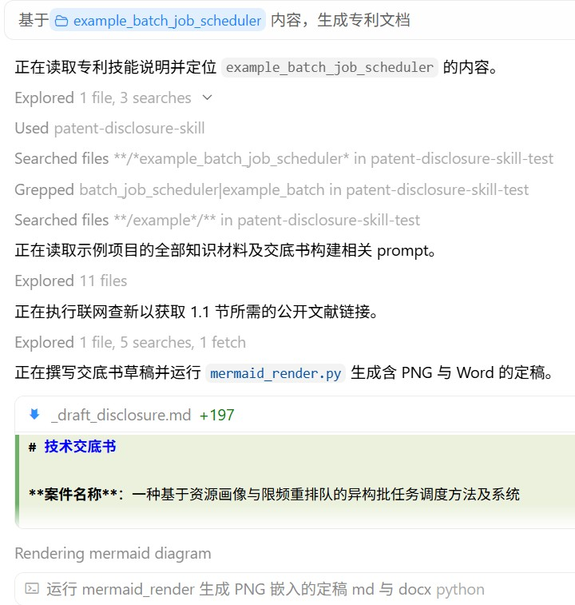
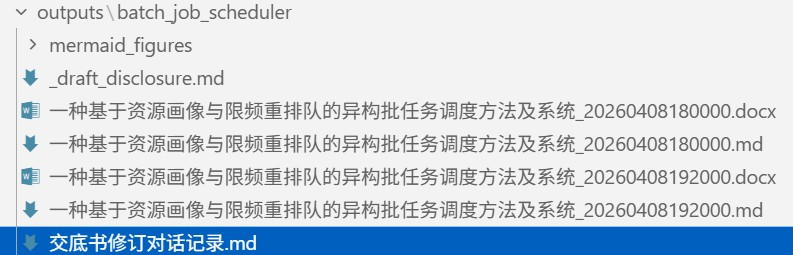

# 中国专利.skill

> 专利点挖掘、交底书（发明/实用/外观）与申请文件编写；按图或权要等多条件检索；通俗解读专利和地图探索；审查政策解读；辅助审查答复。

 

有设计文档和代码，但**专利点还没梳**？交底书要**框图 + 可改 Word**？ 
定稿后还要**多轮补材料、纠错**并留下修改追溯？ 
公开专利晦涩难懂，想**快速看懂权要与落地语境**？

[初衷](#初衷) · [运行效果](#运行效果) · [子技能列表](#子技能列表) · [支持作者](#支持作者) · [参考文档](#参考文档) · [安装说明](INSTALL.md) · [技能入口](SKILL.md)

---

## 初衷

### 专利交底书编写

> **做了多年核心研发，专利发明人那一栏从没写过我的名字。**

代码是自己敲的，方案是自己扛的，轮到交底书却卡在「专利点怎么挖、查新怎么写、框图和 Word 怎么一次交得出去」。本技能把这一环打通：覆盖发明 / 实用新型 / 外观设计，结构图与外观图都能读懂、写进交底；从项目材料梳出可申请的点，查新、脱敏、成文、迭代另存——让真正干活的人，也能把技术贡献写进可交付的交底书里。

### 专利通俗解读

> **不止一篇。**

公开专利常把阅读门槛抬得很高：权要绕、术语密、落地语境散落在说明书与附图里。本技能把单篇读成通俗笔记与图谱，并入库 Obsidian；依托双链、图谱、插件与 Bases 等生态，陆续解读的专利可以沉淀成**只属于自己的私有专利知识库**——权要、术语、线索与附图彼此勾连，越读越厚。再叠上 [Obsidian CLI](https://help.obsidian.md/cli) 与库内外连接能力，检索、批处理、和外部工具接力都更容易：从单篇通俗笔记，走向可检索、可关联、可继续生长的个人专利情报层，把沉睡在 PDF 里的技术细节重新点亮。库厚了之后，还能在这层之上做**专利比对、挖掘与分析**——同族对照、技术路线梳理、差异点扫描，把「读懂」推进到「用起来」。

---

## 运行效果

### 专利交底书编写

<table width="100%" border="1" cellpadding="12" cellspacing="0">
<tr>
<th width="50%" align="center">初版生成 首次落盘交付</th>
<th width="50%" align="center">迭代更新 多版本并存 + 对话记录</th>
</tr>
<tr>
<td width="50%" valign="top" align="center">

</td>
<td width="50%" valign="top" align="center">

</td>
</tr>
</table>

### 实用新型 / 外观 · 看图与出图

<table width="100%" border="1" cellpadding="12" cellspacing="0">
<tr>
<th width="33%" align="center">外观线稿 从产品图自动提炼造型轮廓</th>
<th width="33%" align="center">实用新型线稿 从结构图自动生成轮廓与部件序号引出</th>
<th width="34%" align="center">CAD 三维模型投影 从工程模型自动提取等轴测等多视角</th>
</tr>
<tr>
<td width="33%" valign="top" align="center">

</td>
<td width="33%" valign="top" align="center">

</td>
<td width="34%" valign="top" align="center">

</td>
</tr>
</table>

### 专利通俗解读 · 地图探索

<table width="100%" border="1" cellpadding="12" cellspacing="0">
<tr>
<th width="33%" align="center">Obsidian 关系图 知识图谱与多色节点</th>
<th width="33%" align="center">解读 Canvas 叙事故事线 · 术语 · 公开线索</th>
<th width="34%" align="center">专利地图 地形沙盘 · 四象限 · 引证网络 · 功效矩阵</th>
</tr>
<tr>
<td width="33%" valign="top" align="center">

</td>
<td width="33%" valign="top" align="center">

</td>
<td width="34%" valign="top" align="center">

</td>
</tr>
</table>

---

## 子技能列表

<!-- 技能单行（防 code 在连字符处折行）；名称/详情收紧；触发可换行；剩余给能力。整表 width=100%，不要撑出横向滚动条 -->
<table width="100%">
<colgroup>
<col width="22%">
<col width="10%">
<col>
<col width="18%">
<col width="6%">
</colgroup>
<thead>
<tr>
<th align="left" nowrap>技能</th>
<th align="left" nowrap>名称</th>
<th align="left">能力</th>
<th align="left">触发</th>
<th align="left" nowrap>详情</th>
</tr>
</thead>
<tbody>
<tr>
<td nowrap><a href="skills/patent-disclosure/README.md"><code style="white-space:nowrap">patent-disclosure</code></a></td>
<td nowrap>交底书编写</td>
<td>不会写专利也没关系：材料丢进来，挖出真正能保护的点、查一圈在先技术，直接变成能交差的交底书（发明 / 实用新型 / 外观）。首篇定稿后还可做保护型 1+N 专利布局</td>
<td>「交底书」</td>
<td nowrap><a href="skills/patent-disclosure/README.md">详情</a></td>
</tr>
<tr>
<td nowrap><a href="skills/patent-application/README.md"><code style="white-space:nowrap">patent-application</code></a></td>
<td nowrap>申请文件</td>
<td>已有交底，改成权要、说明书、摘要和附图；说不清的写入问题清单，不挡住整套文件</td>
<td>「申请文件」· 「申请底稿」</td>
<td nowrap><a href="skills/patent-application/README.md">详情</a></td>
</tr>
<tr>
<td nowrap><a href="skills/patent-docket/README.md"><code style="white-space:nowrap">patent-docket</code></a></td>
<td nowrap>案卷会稿</td>
<td>角色扮演交底工程师 vs 专利代理师：自主多轮规划工作流，材料一丢就出交底和申请，缺事实就问、绝不瞎编</td>
<td>「交底申请一起做」· 「从零出交底和申请」</td>
<td nowrap><a href="skills/patent-docket/README.md">详情</a></td>
</tr>
<tr>
<td nowrap><a href="skills/patent-reader/README.md"><code style="white-space:nowrap">patent-reader</code></a></td>
<td nowrap>通俗解读</td>
<td>专利全文读不下去：公开号或 PDF 丢进来，换成普通人能看懂的笔记和图谱；推进 Obsidian 后能串起多件专利关联</td>
<td>「读专利」</td>
<td nowrap><a href="skills/patent-reader/README.md">详情</a></td>
</tr>
<tr>
<td nowrap><a href="skills/patent-map/README.md"><code style="white-space:nowrap">patent-map</code></a></td>
<td nowrap>专利地图</td>
<td>解读入库攒下来的案子摊开成图：语义地形、申请人四象限、同族引证网络、技术功效矩阵、仪表盘；本地私有化运行，浏览器打开即可</td>
<td>「专利地图」· 「案例地图」</td>
<td nowrap><a href="skills/patent-map/README.md">详情</a></td>
</tr>
<tr>
<td nowrap><a href="skills/patent-oa/README.md"><code style="white-space:nowrap">patent-oa</code></a></td>
<td nowrap>审查答复辅助</td>
<td>审查意见别对着发懵：拆条款问答、起草答复稿；可把历史案脱敏进库，对照旧打法辅助答复</td>
<td>「审查答复」· 「审查意见」</td>
<td nowrap><a href="skills/patent-oa/README.md">详情</a></td>
</tr>
<tr>
<td nowrap><a href="skills/patent-chart/README.md"><code style="white-space:nowrap">patent-chart</code></a></td>
<td nowrap>权利要求对照表</td>
<td>把独权拆成特征格，和对比文件 / 产品 / 标准逐格填证据与强弱；主交付 Excel，不构成法律意见</td>
<td>「对照表」· 「claim chart」</td>
<td nowrap><a href="skills/patent-chart/README.md">详情</a></td>
</tr>
<tr>
<td nowrap><a href="skills/patent-search/README.md"><code style="white-space:nowrap">patent-search</code></a></td>
<td nowrap>著录检索</td>
<td>人名、公司、分类号照查；更能扔一张产品图或一段权要，倒推出检索式去翻公布公告</td>
<td>「著录检索」</td>
<td nowrap><a href="skills/patent-search/README.md">详情</a></td>
</tr>
<tr>
<td nowrap><a href="skills/patent-exam-policy/README.md"><code style="white-space:nowrap">patent-exam-policy</code></a></td>
<td nowrap>政策简报</td>
<td>对照国知局官网近期政策消息出人话简报，分析技能里哪些交底技巧、申请书式可能过时，审查口径一变就能跟上</td>
<td>「政策简报」· 「政策雷达」</td>
<td nowrap><a href="skills/patent-exam-policy/README.md">详情</a></td>
</tr>
</tbody>
</table>

---

## 支持作者

如果这个 Skill 对您有帮助，可以请我喝杯咖啡☕随缘支持，感谢感谢🙏🙏

<table width="70%" border="1" cellpadding="12" cellspacing="0">
<tr>
<th width="40%" align="center">随缘支持</th>
<th width="60%" align="center">Star History</th>
</tr>
<tr>
<td width="40%" valign="middle" align="center">

</td>
<td width="60%" valign="middle" align="center">

</td>
</tr>
</table>

---

## 使用边界与合规

本技能为**内部工作底稿辅助**，不构成法律意见，不做新颖性/创造性/授权结论。**在中国，代为撰写专利申请文件、代为办理专利申请、代为答复审查意见等属专利代理业务**，须由依法设立的专利代理机构及取得执业证的专利代理师办理（《专利代理条例》第 9、24 条）；无资质主体以本技能产出对外提交或替他人办理，可能承担行政责任。建议：交底书可自行完成或交给代理师；**申请文件四件套与审查答复稿应经有资质专利代理师复核后使用**。著录检索/解读/对照表仅用公开专利信息，限个人研究与内部流程；遵守目标站点使用条款，勿高频/批量商业抓取。案例库默认脱敏。

---

## 参考文档

- [技能入口与 Agent 流程](SKILL.md)（交底 / 申请文件 / 案卷会稿 / 著录检索 / 解读 / 政策简报 / 审查答复）
- [详细安装说明](INSTALL.md)
- [Obsidian 安装与可选社区插件（Windows）](skills/patent-reader/docs/obsidian-setup-guide.md)

---

MIT License © [handsomestWei](https://github.com/handsomestWei/)。本仓库基于其 [patent-disclosure-skill](https://github.com/handsomestWei/patent-disclosure-skill)，完整保留上游版权与许可声明；本次新增内容（`patent-application` / `patent-chart` 等子包与合规边界表述）以贡献形式并入，改造记录见 [docs/CONTRIB-changes.md](docs/CONTRIB-changes.md)。

